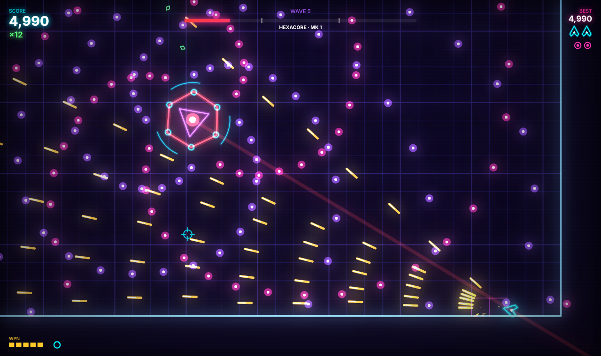
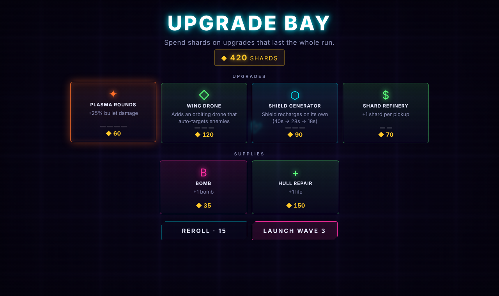
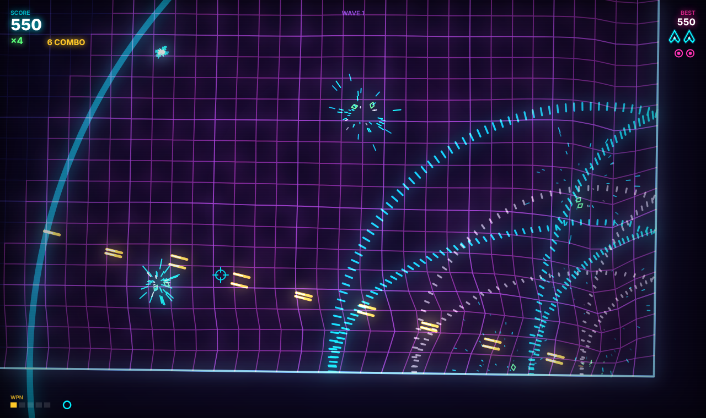
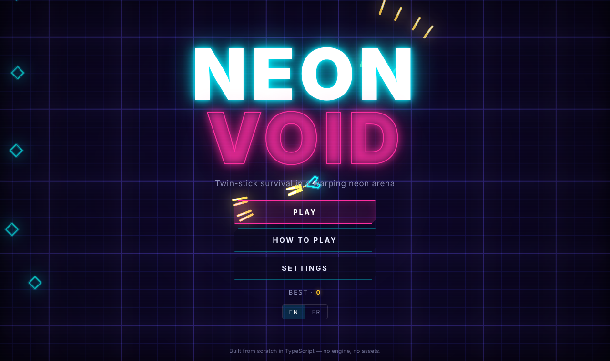

<div align="center">

# NEON VOID

**A twin-stick arena shooter built from scratch in TypeScript: no game engine, no image or sound files.**
**Un twin-stick shooter d'arène codé de zéro en TypeScript, sans moteur de jeu ni fichiers image ou audio.**

[▶ Play in your browser / Jouer dans le navigateur](https://YOUR-USERNAME.github.io/neon-void/)




</div>

[English](#english) · [Français](#français)

---

## English

### The game

You're a lone ship in a neon arena, and the grid under it bends and ripples with every explosion. Survive escalating waves, collect green shards to raise your score multiplier, and take down **HEXACORE**, a three-phase bullet-hell boss that shows up every 5 waves.

- **6 enemy types**, each with its own behavior: wanderers, homing seekers, *dodgers* that sidestep your bullets, splitters, gunners that keep their distance, and **singularities** that bend your bullets, pull in your ship and swallow other enemies until they blow up.
- **Boss with 3 phases**: spirals, rings with a gap you can slip through, aimed fans, minion summons and telegraphed charges that bounce off the walls.
- **Upgrade bay (roguelite)**: shards are also your currency. After waves 2, 5, 7, 10 and so on, spend them on upgrades that last the whole run: fire rate, plasma damage, thrusters, dash cooldown, tractor field, **orbiting wing drones** that aim on their own, a **self-recharging shield**, and a shard refinery. You get 4 random offers per visit, plus a reroll that costs more each time, and bombs and hull repairs are always for sale.
- **Power-ups**: weapon levels (up to 7 streams with piercing), shield, overdrive, magnet, bombs, extra lives. A pity timer stops long dry spells.
- **Game feel**: hit-stop, slow motion, trauma-based screen shake, flashes, combos and floating scores.
- **Plays anywhere**: keyboard + mouse, **gamepad** (standard mapping), or **touch** with two floating virtual sticks.
- **Bilingual UI** (EN/FR, auto-detected), saved settings and high score, and support for `prefers-reduced-motion`.
- **Attract mode**: on the title screen an AI pilot plays the game behind the menu.

### Controls

| Action | Keyboard / Mouse | Gamepad | Touch |
|---|---|---|---|
| Move | WASD / ZQSD / Arrows | Left stick | Left thumb |
| Aim & fire | Mouse + left click | Right stick / RT | Right thumb |
| Dash (i-frames) | Shift | A / LB | DASH button |
| Bomb | Space / Right click | B / RB | BOMB button |
| Pause | Esc / P | Start | ❚❚ button |
| Mute | M | — | Pause menu |

### Technical highlights

What this project demonstrates:

| System | What's interesting |
|---|---|
| **Fixed-timestep loop** (`engine/loop.ts`) | 120 Hz deterministic simulation that doesn't depend on display refresh rate, with spiral-of-death protection. |
| **Bloom post-process** (`engine/renderer.ts`) | Two-octave downsample + blur pipeline in Canvas2D composited additively. It feature-detects `ctx.filter` and falls back to bilinear downsampling. |
| **Spring-mass warp grid** (`game/grid.ts`) | About 1,300 point masses and 2,600 damped springs stored in struct-of-arrays `Float32Array`s. Explosions push it, singularities pull it in, and the ship leaves a wake. |
| **Particle system** (`game/particles.ts`) | 12k-particle ring buffer with zero allocations per frame. A **counting sort** groups particles by color, alpha and width so each batch is a single `stroke()`, about 70 draw calls instead of 12,000. |
| **Spatial hashing** (`engine/spatialHash.ts`) | Uniform-grid broadphase for bullet-vs-enemy hits, flocking separation and bullet-dodging AI. Queries de-duplicate with a stamp instead of allocating a `Set`. |
| **Procedural audio** (`engine/audio.ts`, `synth.ts`, `music.ts`) | No audio files at all. 27 layered sound effects are built from oscillators, FM pairs, filtered noise and distortion. They are panned by screen position, sent through a generated convolution reverb, and big hits duck the music. Shard pickups climb a pentatonic scale, so collecting a chain plays a melody. The adaptive soundtrack has four songs (title, game, boss, upgrade bay) that switch on the next bar line. In-game, new layers come in as the action builds and the kick pumps the mix sidechain-style. Pausing or shopping muffles everything through a lowpass. A test harness renders each sound offline with `OfflineAudioContext` and checks its level. |
| **Wave director** (`game/waves.ts`) | Deterministic, seeded and budget-based. Enemies are bought from a budget that grows with each wave, new enemies get a debut wave, and groups spawn in formations. It's fully unit-tested. |
| **Unified input** (`engine/input.ts`) | Keyboard, mouse, gamepad and multi-touch all reduce to one abstract state, and the last device you touched wins. |
| **Upgrade economy** (`game/upgrades.ts`) | Pure, data-driven upgrade definitions with rising prices, Fisher–Yates offer rolls that avoid maxed items, and stats derived from levels. It's unit-tested. |
| **Spatial menu navigation** (`ui/menuNav.ts`) | The whole DOM UI works with a gamepad (D-pad or stick, A and B) and arrow keys. Focus moves to the nearest element in that direction, and sliders and selects can be adjusted in place. |
| **Typed i18n** (`game/i18n.ts`) | TypeScript and a test both check that every key exists in every language. |

Gameplay code reaches the browser only through small interfaces (`WorldHooks`, `BossHost`). That keeps the simulation testable and lets the title screen run the same `World` with an AI providing the `Controls`.

### Getting started

```bash
npm install
npm run dev        # dev server with HMR
npm test           # unit tests (vitest)
npm run build      # typecheck + production build into dist/
```

### Deploy to GitHub Pages

1. Push this repo to GitHub as `neon-void` (or any name; the build uses relative paths).
2. Open **Settings → Pages → Source** and choose **GitHub Actions**.
3. Each push to `main` runs the tests, builds the game and deploys it with `.github/workflows/deploy.yml`.
4. Replace `YOUR-USERNAME` in the link at the top of this README.

### Project structure

```
src/
├── engine/           # reusable, game-agnostic
│   ├── audio.ts      # WebAudio synth + sequencer
│   ├── input.ts      # keyboard / mouse / gamepad / touch
│   ├── loop.ts       # fixed-timestep loop
│   ├── math.ts       # vector & easing helpers
│   ├── renderer.ts   # canvas, camera, shake, bloom
│   ├── rng.ts        # seedable PRNG (mulberry32)
│   ├── spatialHash.ts
│   └── storage.ts    # safe localStorage
├── game/
│   ├── world.ts      # simulation & rules
│   ├── boss.ts       # HEXACORE state machine
│   ├── waves.ts      # wave director
│   ├── grid.ts       # spring-mass warp grid
│   ├── particles.ts
│   ├── shapes.ts     # procedural vector art
│   ├── hud.ts
│   ├── entities.ts
│   ├── config.ts     # tunables & palette
│   ├── upgrades.ts   # roguelite upgrade economy
│   └── i18n.ts
├── ui/
│   ├── shop.ts       # upgrade bay screen
│   └── menuNav.ts    # gamepad / arrow-key menu navigation
└── main.ts           # app shell & state machine
tests/                # vitest suites
```

---

## Français

### Le jeu

Vous pilotez un vaisseau seul dans une arène néon, et la grille sous vos pieds se déforme et ondule à chaque explosion. Survivez à des vagues de plus en plus difficiles, ramassez les éclats verts pour faire monter votre multiplicateur et abattez **HEXACORE**, un boss bullet-hell en trois phases qui apparaît toutes les 5 vagues.

- **6 types d'ennemis**, chacun avec son comportement : rôdeurs, traqueurs à tête chercheuse, *esquiveurs* qui évitent vos tirs, diviseurs, artilleurs qui gardent leurs distances, et **singularités** qui courbent vos projectiles, attirent votre vaisseau et avalent les autres ennemis jusqu'à exploser.
- **Boss en 3 phases** : spirales, anneaux avec une ouverture pour passer, tirs en éventail, invocation de sbires et charges annoncées qui rebondissent sur les murs.
- **Atelier (roguelite)** : les éclats servent aussi de monnaie. Après les vagues 2, 5, 7, 10, etc., achetez des améliorations valables toute la partie : cadence, dégâts plasma, propulseurs, recharge d'esquive, rayon tracteur, **drones d'escorte** qui visent tout seuls, **bouclier qui se recharge** et raffinerie d'éclats. Chaque visite propose 4 offres au hasard, avec une relance de plus en plus chère, et les bombes et réparations sont toujours en vente.
- **Bonus** : niveaux d'arme (jusqu'à 7 flux de tir perforants), bouclier, surcharge, aimant, bombes, vies supplémentaires. Un système anti-malchance évite les longues séries sans bonus.
- **Sensations de jeu** : arrêt sur impact (hit-stop), ralenti, tremblement d'écran progressif, flashs, combos et scores flottants.
- **Jouable partout** : clavier + souris, **manette** (mapping standard) ou **tactile** avec deux joysticks virtuels flottants.
- **Interface bilingue** (FR/EN, détectée automatiquement), paramètres et record sauvegardés, prise en charge de `prefers-reduced-motion`.
- **Mode démo** : sur l'écran titre, une IA pilote le vaisseau derrière le menu.

### Commandes

| Action | Clavier / Souris | Manette | Tactile |
|---|---|---|---|
| Se déplacer | WASD / ZQSD / Flèches | Stick gauche | Pouce gauche |
| Viser et tirer | Souris + clic gauche | Stick droit / RT | Pouce droit |
| Esquive (invulnérable) | Maj | A / LB | Bouton DASH |
| Bombe | Espace / clic droit | B / RB | Bouton BOMB |
| Pause | Échap / P | Start | Bouton ❚❚ |
| Couper le son | M | — | Menu pause |

### Points techniques

- **Boucle à pas fixe** à 120 Hz : simulation déterministe, quelle que soit la fréquence de l'écran.
- **Bloom** en deux octaves (sous-échantillonnage + flou) en Canvas2D, avec détection de `ctx.filter` et une solution de repli.
- **Grille masses-ressorts** : environ 1 300 points et 2 600 ressorts amortis stockés dans des `Float32Array`.
- **Particules** : tampon circulaire de 12 000 particules, aucune allocation par image, et un **tri par comptage** qui réduit les appels de dessin à environ 70 lots.
- **Hachage spatial** pour les collisions, la séparation des essaims et l'IA d'esquive.
- **Audio 100 % procédural** : 27 effets en couches (FM, bruit filtré, distorsion) positionnés en stéréo, avec réverbération et atténuation de la musique sur les gros impacts. Les éclats jouent une gamme pentatonique. La bande-son adaptative compte quatre morceaux (titre, jeu, boss, atelier) qui s'enchaînent à la mesure, avec un effet de pompage et un filtre étouffé en pause.
- **Directeur de vagues** déterministe à budget, couvert par des tests unitaires.
- **i18n typée** : TypeScript et un test vérifient que chaque clé est traduite dans chaque langue.

### Démarrer

```bash
npm install
npm run dev     # serveur de développement
npm test        # tests unitaires
npm run build   # vérification des types + build de production
```

### Déployer sur GitHub Pages

Poussez le dépôt sur GitHub, puis choisissez **Settings → Pages → Source : GitHub Actions**. Le workflow fourni lance les tests, compile le jeu et le déploie à chaque push sur `main`.

---

<div align="center">




MIT License
</div>
