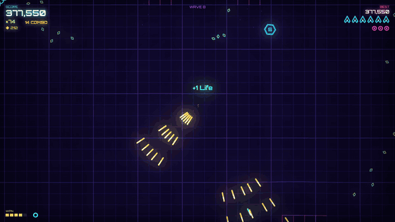
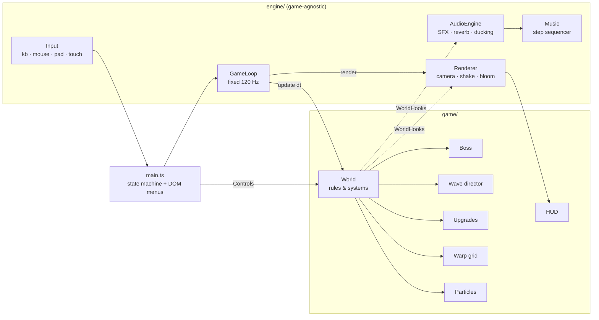

<div align="center">

# NEON VOID

**A twin-stick arena shooter built from scratch in TypeScript.**<br>
No game engine, no image files, no audio files: every pixel and every sound is generated in code.

[**▶ Play in your browser**](https://YOUR-USERNAME.github.io/neon-void/) · [Version française](#français)

[](https://github.com/YOUR-USERNAME/neon-void/actions/workflows/deploy.yml)




</div>

## About

You pilot a lone ship in a neon arena whose grid bends and ripples with every explosion. Survive escalating waves, collect shards to grow your score multiplier, spend them on upgrades between waves, and take down **HEXACORE**, a three-phase bullet-hell boss that returns, stronger, every five waves.

I built it to practise the parts of game development that an engine usually hides: the game loop, rendering and post-processing, physics, collision broadphase, audio synthesis, input handling and UI. The design favours small, testable modules over a framework.

<table>
  <tr>
    <td width="50%"></td>
    <td width="50%"></td>
  </tr>
  <tr>
    <td align="center"><sub>HEXACORE, phase 2: gapped bullet rings and aimed fans</sub></td>
    <td align="center"><sub>Upgrade bay: 4 random offers, reroll, supplies</sub></td>
  </tr>
</table>

## Features

- **6 enemy types with distinct AI.** Wanderers, homing seekers, _dodgers_ that sidestep incoming bullets, splitters, gunners that hold their distance, and singularities that bend your shots, pull in your ship and swallow other enemies until they go supernova.
- **A three-phase boss.** Breathing spirals, rings with a deliberate gap, aimed fans, minion summons and telegraphed charges that bounce off the walls. Every pattern leaves a readable way out.
- **Roguelite upgrade bay.** Shards double as currency. After waves 2, 5, 7, 10 and so on, buy run-long upgrades: fire rate, damage, thrusters, dash cooldown, pickup range, orbiting **auto-aiming drones**, a **self-recharging shield** and a shard refinery.
- **Game feel.** Hit-stop, slow motion, trauma-based screen shake, flashes, combos, floating scores, a wave-clear bonus (doubled when flawless) and a heartbeat warning on your last life.
- **Adaptive procedural soundtrack.** Four songs (title, battle, boss, shop) switch on the bar line, and the battle track adds layers as the action builds.
- **Plays anywhere.** Keyboard and mouse, gamepad, or touch with two floating virtual sticks. The menus also work with a gamepad or the arrow keys.
- **Bilingual (EN/FR).** The language is auto-detected, settings and best score are saved, and `prefers-reduced-motion` is respected.
- **Attract mode.** On the title screen an AI pilot plays the real game behind the menu.

### Controls

| Action          | Keyboard / mouse    | Gamepad          | Touch       |
| --------------- | ------------------- | ---------------- | ----------- |
| Move            | WASD / ZQSD, arrows | Left stick       | Left thumb  |
| Aim and fire    | Mouse + left click  | Right stick / RT | Right thumb |
| Dash (i-frames) | Shift               | A / LB           | DASH        |
| Bomb            | Space / right click | B / RB           | BOMB        |
| Pause           | Esc / P             | Start            | ❚❚          |
| Mute            | M                   | —                | Pause menu  |

## Engineering highlights

| Area          | What it does                                                                                                                                                                                                         | Where                              |
| ------------- | -------------------------------------------------------------------------------------------------------------------------------------------------------------------------------------------------------------------- | ---------------------------------- |
| Game loop     | Fixed 120 Hz timestep with an accumulator, so the simulation behaves the same at 60 Hz and 144 Hz. Clamped to avoid the spiral of death.                                                                             | `engine/loop.ts`                   |
| Rendering     | Canvas2D scene drawn additively, then a two-octave bloom (downsample + blur) composited on top. Detects `ctx.filter` and falls back to bilinear blur.                                                                | `engine/renderer.ts`               |
| Warp grid     | About 1,300 point masses and 2,600 damped springs in struct-of-arrays `Float32Array`s, stepped at 60 Hz. Explosions push it, singularities pull it in.                                                               | `game/grid.ts`                     |
| Particles     | A 12,000-particle ring buffer with no per-frame allocation. A counting sort groups particles by colour, alpha and width, so the whole system draws in about 70 `stroke()` calls.                                     | `game/particles.ts`                |
| Collisions    | Uniform-grid spatial hash used for bullet hits, swarm separation and the bullet-dodging AI. Queries de-duplicate with a stamp instead of allocating a `Set`.                                                         | `engine/spatialHash.ts`            |
| Audio         | 27 layered sound effects from oscillators, FM pairs, filtered noise and waveshaping, with stereo panning by screen position, a generated convolution reverb, ducking on big hits and a lowpass "muffle" when paused. | `engine/audio.ts`, `synth.ts`      |
| Music         | A lookahead step sequencer on the AudioContext clock (sample-accurate). Songs change on the next bar line, and the kick sidechain-pumps the mix. Shard pickups climb a pentatonic scale, so a chain plays a melody.  | `engine/music.ts`                  |
| Wave director | Seeded and deterministic. Each wave buys enemies from a growing budget and releases them in formations, and a newly unlocked enemy gets a debut wave.                                                                | `game/waves.ts`                    |
| Economy       | Data-driven upgrade definitions with escalating prices and Fisher–Yates offer rolls that skip maxed items. Combat stats are derived from upgrade levels.                                                             | `game/upgrades.ts`                 |
| Input and UI  | Keyboard, mouse, gamepad and multi-touch reduce to one abstract state. A spatial focus navigator makes the DOM menus usable with a gamepad.                                                                          | `engine/input.ts`, `ui/menuNav.ts` |
| i18n          | Typed dictionaries: TypeScript and a test both check that every key exists in every language.                                                                                                                        | `game/i18n.ts`                     |

### Architecture



The simulation reaches the outside world only through two small interfaces, `WorldHooks` and `BossHost`. That keeps gameplay deterministic and testable: the test suite runs the real `World` headless in Node with stub hooks, and the title screen runs the same `World` with an AI supplying the `Controls`.

### Testing

`npm test` runs 33 Vitest tests:

- **Engine:** math, the seeded RNG and spatial hashing.
- **Rules:** the wave director's budget and unlocks, upgrade pricing and offer rolls, and i18n completeness.
- **Headless simulation:** a 3-minute AI-piloted run that checks no value becomes NaN, plus shop open/close, wave-clear and extra-life rules, single game-over reporting, and a regression test that the boss stops firing after the player dies.
- **Music:** song queueing.

CI (`.github/workflows/deploy.yml`) runs typecheck, ESLint, the Prettier check, the tests and both builds on every push, then deploys `main` to GitHub Pages.

## Getting started

Requires Node 20 or newer.

```bash
npm install
npm run dev          # dev server with hot reload
```

| Script                 | Purpose                                                               |
| ---------------------- | --------------------------------------------------------------------- |
| `npm run build`        | Typecheck, then a production build into `dist/`                       |
| `npm run build:single` | One self-contained `dist-standalone/neon-void.html` that runs offline |
| `npm test`             | Unit and simulation tests                                             |
| `npm run lint`         | ESLint (typescript-eslint)                                            |
| `npm run format`       | Prettier                                                              |
| `npm run check`        | Everything CI checks, locally                                         |

### Deploy to GitHub Pages

1. Push the repository to GitHub. The build uses relative paths, so any repository name works.
2. In **Settings → Pages**, set **Source** to **GitHub Actions**.
3. Every push to `main` is tested, built and deployed. Then replace `YOUR-USERNAME` in this README and in `package.json`.
4. Optional: upload `docs/social-preview.png` in **Settings → General → Social preview** for a nicer link card.

### Project structure

```
src/
├── engine/            game-agnostic building blocks
│   ├── loop.ts        fixed-timestep loop
│   ├── renderer.ts    canvas, camera, screen shake, bloom
│   ├── input.ts       keyboard / mouse / gamepad / touch
│   ├── audio.ts       mix bus, reverb, ducking, 27 SFX
│   ├── synth.ts       oscillator / FM / noise primitives
│   ├── music.ts       adaptive 4-song sequencer
│   ├── spatialHash.ts broadphase collisions
│   ├── rng.ts         seedable PRNG (mulberry32)
│   ├── math.ts · storage.ts
├── game/
│   ├── world.ts       simulation and rules
│   ├── boss.ts        HEXACORE state machine
│   ├── waves.ts       wave director
│   ├── upgrades.ts    roguelite economy
│   ├── grid.ts        spring-mass warp grid
│   ├── particles.ts   batched particle system
│   ├── shapes.ts      procedural vector art
│   ├── hud.ts · entities.ts · config.ts · i18n.ts
├── ui/
│   ├── shop.ts        upgrade bay screen
│   └── menuNav.ts     gamepad / arrow-key menu navigation
└── main.ts            app shell and state machine
tests/                 Vitest suites (engine, rules, headless simulation)
scripts/               single-file build
```

### Ideas for next steps

- Online leaderboard and a daily seeded challenge (the wave director is already deterministic).
- More game modes (Pacifism, Time Attack) and a second boss.
- A WebGL renderer behind the same `Renderer` interface for higher particle counts.

---

## Français

**NEON VOID** est un twin-stick shooter d'arène codé de zéro en TypeScript, sans moteur de jeu ni fichiers image ou audio : tout est généré par le code. [**▶ Jouer dans le navigateur**](https://YOUR-USERNAME.github.io/neon-void/)

Vous pilotez un vaisseau dans une arène néon dont la grille se déforme à chaque explosion. Survivez aux vagues, ramassez les éclats pour augmenter votre multiplicateur, dépensez-les à l'atelier entre les vagues et battez **HEXACORE**, un boss en trois phases qui revient toutes les cinq vagues.

**Contenu du jeu**

- **Ennemis et boss :** 6 types d'ennemis aux comportements distincts, dont un qui esquive vos tirs et une singularité qui courbe vos projectiles. Le boss a trois phases, et ses attaques laissent toujours une issue lisible.
- **Atelier roguelite :** cadence, dégâts, vitesse, esquive, portée de collecte, drones qui visent seuls, bouclier qui se recharge, raffinerie d'éclats.
- **Bande-son adaptative :** quatre morceaux procéduraux (titre, combat, boss, atelier) et 27 effets sonores positionnés en stéréo.
- **Plateformes :** clavier et souris, manette ou tactile. L'interface est en français et en anglais.

**Points techniques**

- **Moteur :** boucle à pas fixe de 120 Hz, bloom en Canvas2D, grille masses-ressorts dans des `Float32Array`.
- **Performance :** 12 000 particules dessinées en environ 70 appels grâce à un tri par comptage, et hachage spatial pour les collisions.
- **Audio :** synthèse WebAudio (FM, bruit filtré, réverbération par convolution) et séquenceur calé sur l'horloge audio.
- **Qualité :** 33 tests, dont une simulation complète du jeu exécutée sans navigateur dans Node. Intégration continue avec vérification des types, ESLint, Prettier, tests et déploiement sur GitHub Pages.

**Démarrer :** `npm install`, puis `npm run dev`. `npm run build:single` produit un fichier HTML unique jouable hors ligne.

---

<div align="center">
<br/>
<sub>Released under the <a href="LICENSE">MIT License</a>.</sub>
</div>
